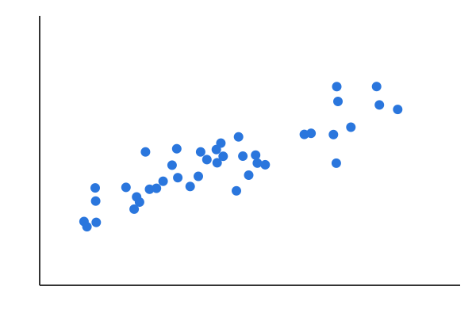

## Start

::: {.poll-qr size="200"}
:::

## Which language do you use most?

::: {.poll #lang}
- R
- Python
- Julia
:::

## Pick the primes

::: {.poll #primes max-choices="3"}
- [x] 2
- [x] 3
- [ ] 4
- [x] 5
:::

## Peer instruction

::: {.poll #peer rounds="2" timer="20"}
A p-value of 0.03 means:

- [ ] 3% chance H0 is true
- [x] Data this extreme 3% of the time under H0
- [ ] 97% chance the result is real
:::

## Quick quiz

::: {.poll #quick timer="3"}
2 + 2 = ?

- [ ] 3
- [x] 4
- [ ] 5
:::

## Classic multi

::: {.poll #classicmulti layout="classic" multiple="true"}
Which do you use?

- Git
- SVN
- Mercurial
:::

## Guess the mean

::: {.estimate #mean min="0" max="100" answer="42" unit="%" tolerance="5"}
What share of people own a bike?
:::

## Open estimate

::: {.estimate #jelly answer="350" tolerance="10%"}
How many jelly beans in the jar?
:::

## Rank the topics

::: {.rank #topics top="3"}
Which topics should we revisit?

- Regression
- Power
- Bayes
- Bootstrap
:::

## Find the outlier

::: {.hotspot #outlier answer="0.71,0.32,0.05"}
Tap the outlier.

:::

## One word

::: {.wordcloud #oneword max-words="2" timer="30"}
:::

## Rate it

::: {.likert #rate scale="agree-5"}
- Clear
- Useful
:::

## Questions

::: {.qa max="5"}
:::

## Leaderboard

::: {.leaderboard}
:::
